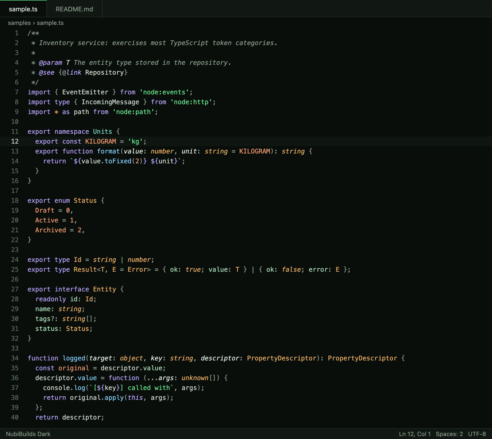
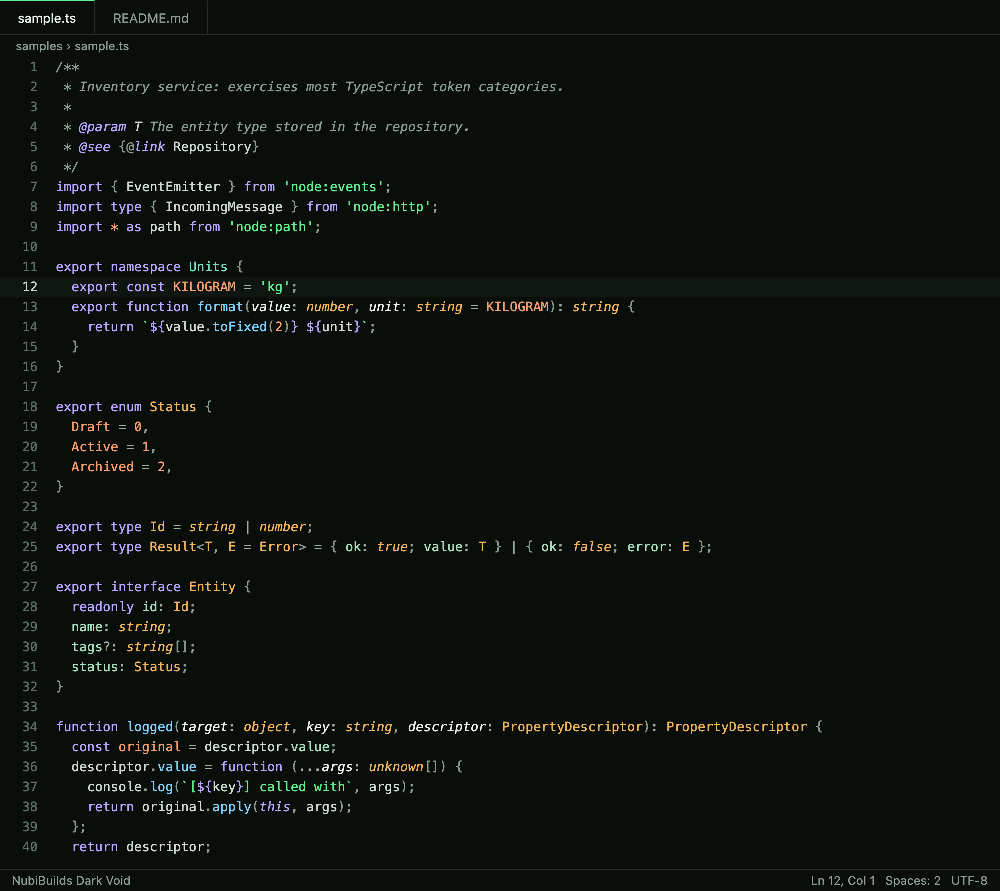
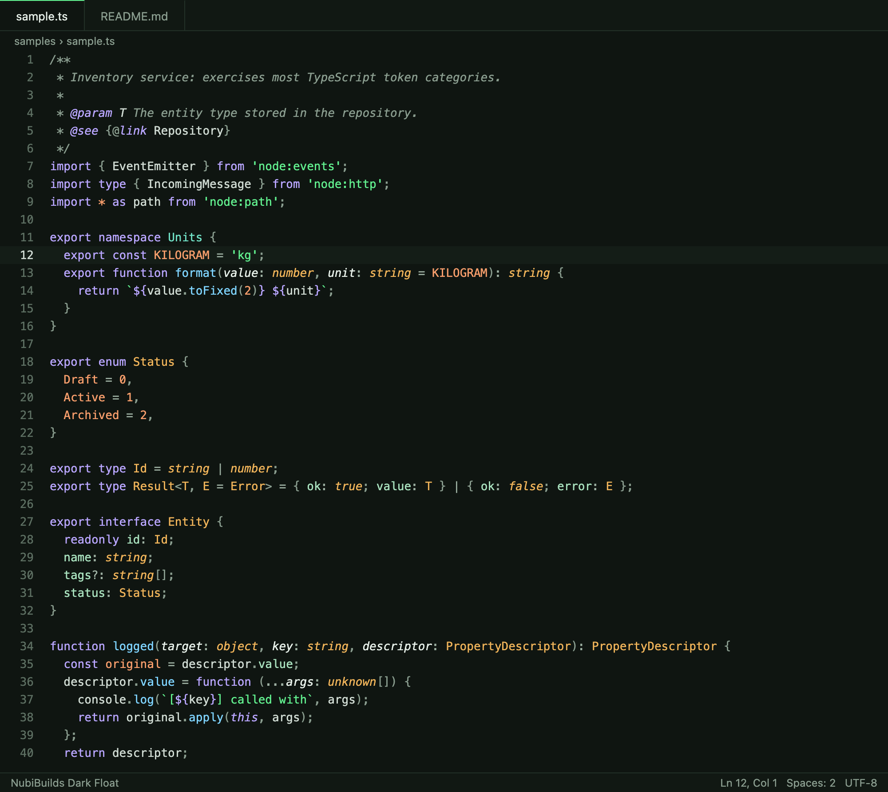

# Previews

| NubiBuilds Dark Void | NubiBuilds Dark Float |
| --- | --- |
|  |  |

More languages in NubiBuilds Dark: [TypeScript](typescript.png) · [JavaScript](javascript.png) · [TSX](tsx.png) · [JSX](jsx.png) · [HTML](html.png) · [CSS](css.png) · [SCSS](scss.png) · [JSON](json.png) · [JSONC](jsonc.png) · [Markdown](markdown.png) · [Python](python.png) · [Java](java.png) · [Go](go.png) · [Rust](rust.png) · [PHP](php.png) · [SQL](sql.png) · [YAML](yaml.png) · [XML](xml.png) · [Shell](shell.png) · [Dockerfile](dockerfile.png)

These images are rendered previews, not window screenshots. They are produced
by running the sample files through the TextMate grammars that ship with VS
Code and colouring the tokens with the theme, so the syntax colours match the
editor. They do not show semantic highlighting, bracket pair colours or the
rest of the workbench.

To show these in the main README, `package.json` needs a `repository` URL first:
the packaging tool refuses relative image paths without one.
